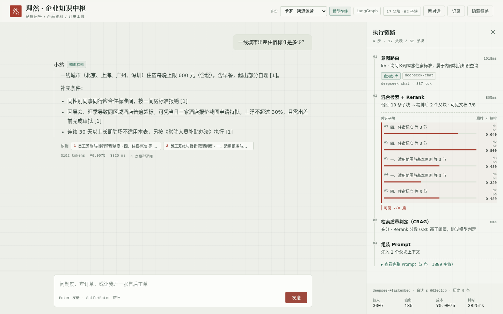
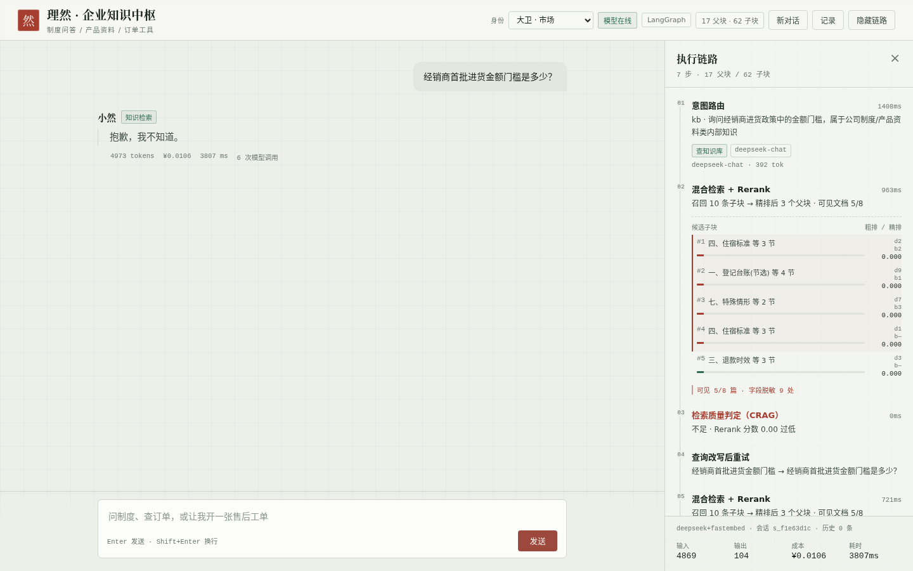
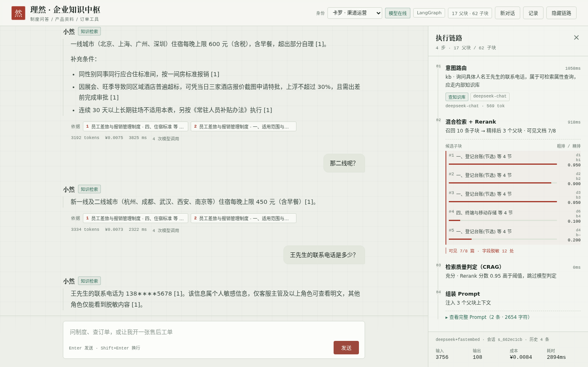
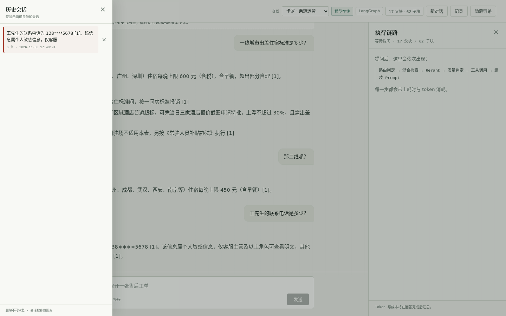
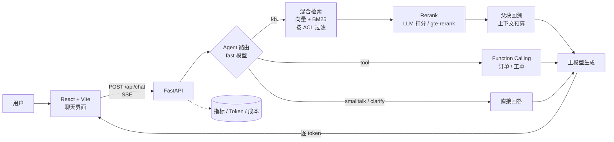
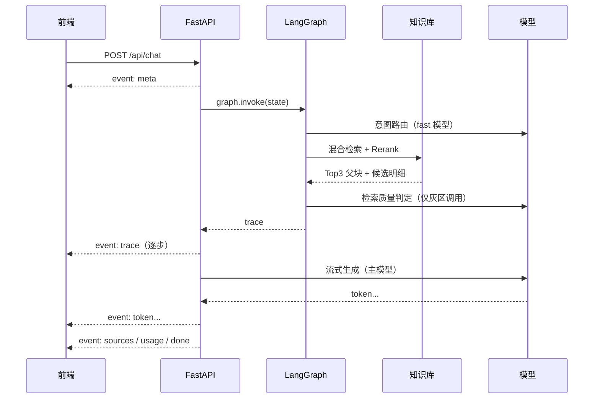
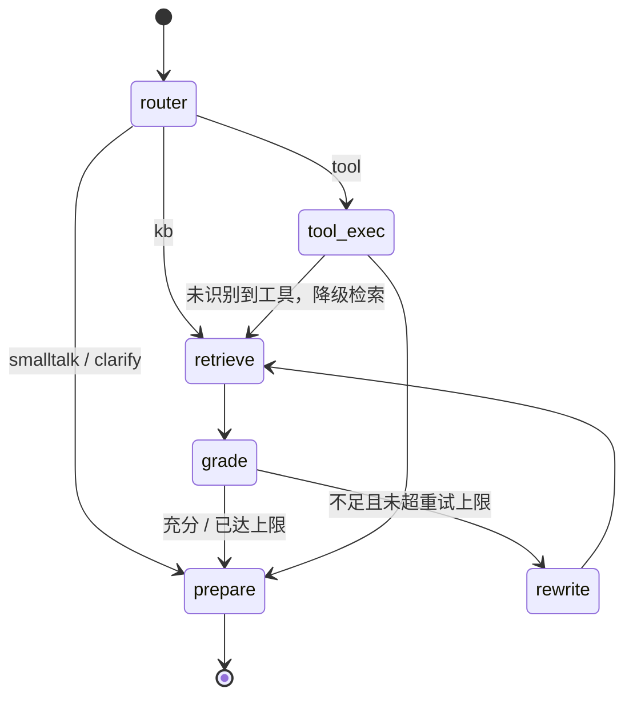

# 企业级智能知识库与业务 Agent 系统

一个能**查制度、答产品问题、查订单、开工单**的企业助手。重点不是把大模型接进来，而是把 RAG 的检索质量、Agent 的可控性、**文档级权限**、**索引更新成本**和全链路可观测性做扎实。

前端不是聊天壳子：每一条回答右侧都能看到**意图路由 → 混合检索 → Rerank → 质量判定 → 上下文组装 → 流式生成**的完整链路，以及每条候选子块的两路排名和精排分数。

顶部可以切换演示身份（HR / 财务 / 渠道 / 市场 / 客服主管 / 访客）。同一个问题，市场部问“经销商进货门槛”会被拒答，渠道运营问则正常回答——权限过滤发生在检索阶段，不是事后删结果。

「记录」里是按身份隔离的历史会话：只能看到自己的对话，点开可恢复上下文，删除不可恢复；顶栏「新对话」随时开一段新会话。

> 默认使用 DeepSeek：`deepseek-chat` 负责路由与生成，本地 `fastembed`（bge-small-zh）做向量，精排用 DeepSeek 做 listwise 打分。三个后端互相独立，也可以切到阿里云百炼（embedding + rerank 一体）或全 Mock。
> **没有 API Key 也能启动**：自动进入 MOCK 模式，用规则模拟模型，整条链路（摄入、检索、Rerank、Agent、评测）都能跑通；填入 Key 后重建索引即为真实效果。

---

## 界面



左侧是对话与引用；右侧是本次请求的完整链路：意图路由、召回候选的两路排名与精排分数、CRAG 判定、Prompt 组装，以及 token 与成本。



市场部问经销商门槛：该文档在检索阶段就被过滤掉，系统拒答，并且不展示任何「依据」（避免把无关文档误标成引用）。同一问题切到渠道运营即可正常回答，右侧还能看到 CRAG 的改写重试过程。



渠道运营看到 `138∗∗∗∗5678`；切到有 `pii` 权限的客服主管才会出现明文，trace 里的脱敏计数从 12 变成 0。



「记录」按身份隔离：只能看到自己的会话，点开恢复上下文（会话 ID 一并恢复，继续提问沿用原记忆），右侧 × 删除。

---

## 1. 项目亮点

- **父子分块（Parent-Child Chunking）**：200 字子块建索引保证召回精度，命中后回溯 600–900 字父块喂给模型保证上下文完整；按标题分节 + 相邻小节合并 + 表格原子切分，不按字数硬切。
- **混合检索 + RRF 融合**：向量检索兜语义、BM25 兜精确词（订单号、金额、百分比），用 Reciprocal Rank Fusion 融合，避免两路分数量纲不一致。
- **Rerank 精排**：粗排 Top10 交给精排层重新打分，只把 Top3 父块放进 Prompt，降低无关上下文干扰。默认用 DeepSeek 做 listwise 打分（DeepSeek 没有 rerank 接口），也可切 gte-rerank 或本地 cross-encoder。
- **LangGraph 状态机 + CRAG 循环**：路由、检索、质量判定、查询改写、工具调用显式编排；检索不足时自动改写并重试（有次数上限），不是黑盒 AgentExecutor。
- **Function Calling 做“事”**：订单查询、创建售后工单是真实函数调用，带参数校验、规则兜底和结果回填，而不是让模型编造物流信息。
- **Token 成本可核算**：每次调用按模型价目表折算人民币，按阶段（route / retrieve / rerank / compose / summarize）拆分，前端实时展示。
- **上下文 O(1) 增长**：滑动窗口保留最近 N 轮，超窗历史用低成本模型压成 200 字摘要，10 轮对话也不会把 Prompt 撑爆。
- **会话管理**：历史会话按身份隔离，可恢复上下文、删除；恢复后继续提问沿用原有记忆，切换身份不会串会话。
- **可评测**：123 题单轮评测 + 6 组多轮对话，覆盖知识问答 / 工具调用 / 闲聊 / 不可回答（测幻觉）/ 权限（测越权）/ 脱敏（测明文泄露）/ 指代消解，支持 LLM-as-Judge 与 Rerank 开关对照，输出 Markdown 报告。
- **文档级权限（ACL）**：文档在 frontmatter 声明可见部门，向量检索与 BM25 都在**打分前**按身份过滤；工具调用同样透传身份，避免成为绕过权限的后门；会话与身份绑定，切换身份不会复用上一位用户的摘要。
- **字段级脱敏（PII）**：文档可以全员可见，但手机号、身份证、银行卡、邮箱需要额外 `pii` 权限；没有权限时在上下文进入 Prompt 之前就打码，模型根本看不到明文。
- **增量索引 + 原子切换**：按内容 hash 检测新增 / 修改 / 删除，只对变化文档重新向量化；重建先写 staging 目录，成功后整体替换，失败则旧索引不受影响。
- **可降级**：没有 Qdrant 用 numpy 向量库，没有 LangGraph 用内置 minigraph，没有 jieba 用字级切分，没有 Key 用 Mock——保证任何环境都能跑。

---

## 2. 架构



一次请求的执行序列：



Agent 状态机（含 CRAG 重试循环）：



更细的模块说明见 [docs/architecture.md](docs/architecture.md)。

---

## 3. 关键设计决策

### 3.1 为什么是父子分块

| 方案 | 召回 | 上下文完整性 | 问题 |
| --- | --- | --- | --- |
| 固定 500 字 | 一般 | 一般 | 句子/表格被切断，答案常被截半 |
| 只切小块（200 字） | 高 | 差 | 模型拿不到完整条款，容易答一半 |
| 只切大块（900 字） | 低 | 好 | 语义被稀释，召回不准 |
| **父子分块** | **高** | **好** | 需要维护 parent 映射与上下文预算 |

实现要点：按 H1/H2 分节 → 相邻小节合并到 900 字以内（避免父块碎成 100 字）→ 句边界切父块 → 父块内再切 220 字子块。子块永远不跨父块，`parent_id` 是 O(1) 回溯。

子块入库文本会自动带上「文档标题｜章节」，解决子块脱离上下文后指代不明的问题。

### 3.2 混合检索为什么用 RRF

向量相似度是 0–1 余弦，BM25 分数无上界，直接加权需要归一化和调参。RRF 只看名次：

```
score(d) = Σ 1 / (k + rank_i(d)),  k = 60
```

工程上更稳，也不依赖某一路的分数分布。BM25 对「ORD-2026-1001」「600」「0.5%」这类精确 token 尤其重要。

### 3.3 Rerank 放在哪一层

粗排 10 条子块 → 精排取前 6 条 → 按父块去重后最多保留 3 个父块。精排池比最终上下文数大一倍，是因为多个子块常属于同一父块，去重后需要候补。

### 3.4 CRAG：检索不够就改写重试

`grade` 节点先用 Rerank 分数做两段判定（高于 0.50 直接采信，低于 0.12 直接判不足），只有灰区才调用 fast 模型。判定不足且未超过重试次数时，走 `rewrite → retrieve` 循环。这是 LangGraph 相对 AgentExecutor 最实际的价值：**显式状态 + 可控循环**。

### 3.5 Token 成本优化

| 手段 | 效果 |
| --- | --- |
| 路由 / 判定 / 摘要用 fast 模型 | 这三类调用占比高但不需要强推理（DeepSeek 下同模型、低温度） |
| Rerank 分数前置判定 | 大部分请求跳过 LLM 质量判定 |
| 只把 Top3 父块放进 Prompt | 上下文从 10 段降到 3 段 |
| 检索父块按字符预算截断 | 最坏情况也有上限（默认 3200 字） |
| 查询向量缓存 | 重复问题不再付 embedding 费用 |
| 滑动窗口 + 摘要压缩 | 历史 token 从线性增长变为近似常数 |
| 输出 `max_tokens=800` | 防止异常长回答 |

所有调用按模型价目表折算人民币并写入 SSE 的 `usage` 事件，前端每条回答下都能看到花了几分钱。

### 3.6 工具调用的安全边界

模型只负责「选工具 + 填参数」，真正的执行在服务端：参数校验、订单号规则兜底、结果原样回填。模型无权拼 SQL、无权访问未授权的数据。当前是 mock 订单库，替换成内部 API 时业务代码不需要改。

### 3.7 文档级权限（ACL）

文档在 frontmatter 里声明可见范围：

```markdown
---
acl: hr
department: 人力资源部
---
```

`all` 表示全员可见，其余是部门代码（`channel|finance|sales`）。权限在**检索阶段**生效，而不是取回结果后再删：

| 环节 | 做法 |
| --- | --- |
| 向量检索 | Qdrant 用 payload 过滤（`doc_id` 的 `MatchAny`）；numpy 后端在打分前按 mask 过滤 |
| BM25 | 打分开头就跳过无权文档，避免它影响 IDF 与名次 |
| 父块回溯 | 再校验一次 `doc_id`，防止向量库过滤失效时越权 |
| 工具调用 | `search_knowledge_base` 透传 `departments`，否则工具会变成绕过权限的后门 |
| 会话 | 会话与 `user_id` 绑定，切身份不复用上一位用户的摘要 |

为什么不在生成后过滤？因为那时光权文档已经进入了 Prompt 与 trace，标题和片段都可能泄露，而且白花了 token。代价是候选池变小，可能召回不足——这属于正确的失败，系统会如实回答“不知道”。

`acl` 参与 `content_hash`，所以只改权限、不改正文也会触发该文档重建。

### 3.8 增量索引

`ingest` 默认增量，按 `content_hash`（正文 + ACL + 归属部门）对比已有 `docs.json`：

- 新增 → 切分、向量化、写入；
- 修改 → 先按 `child_id` 从向量库删除旧块，再重新切分与向量化；
- 删除 → 从向量库与块表中清除；
- 未变 → 完全跳过，不产生 embedding 费用。

实测：8 篇文档、62 个子块，改 1 篇（4 个子块）时只重算 4 条向量；再跑一次是 0 条。`--full` 可强制全量重建。

重建默认写 `index.staging`，成功后把正式目录 rename 成 `index.old`、再把 staging rename 成正式目录，最后清理备份。构建失败时 staging 会被删除，正式索引保持可用——不会出现「读到一半新一半旧」的索引。`--in-place` 可关闭这一行为。

### 3.9 字段级脱敏（PII）

文档可以全员可见，但其中的手机号、身份证、银行卡、邮箱需要额外权限。`pii` 不挂在部门上，而是挂在用户的 `permissions` 上；没有它的用户在**上下文进入 Prompt 之前**就被打码：

| 原文 | 无权限时 |
| --- | --- |
| 13812345678 | 138****5678 |
| 310101199001011234 | 310101********1234 |
| 6222021234567890 | **** **** **** 7890 |
| wangxiaoming@example.com | wan***@example.com |

关键在于时机：模型看不到明文，就不可能复述；引用、trace、候选预览里同样只有掩码。trace 会显示「本次脱敏 12 处」，Prompt 里也要求模型不得猜测或补全 `****` 的内容。

ACL 决定“这篇文档能不能看”，PII 决定“能看时哪些字段要不要打码”，两者都在检索层完成，不依赖生成端自觉。

### 3.10 向量库：Qdrant 的两种形态

| 形态 | 配置 | 适用场景 |
| --- | --- | --- |
| 嵌入式 | 不设 `QDRANT_URL` | 本地开发、CI、单机演示；数据在 `data/index/qdrant` |
| 服务端 | `QDRANT_URL=http://qdrant:6333` | Docker / 生产；`docker-compose` 已内置 qdrant 服务 |

几个实现细节：`child_id` 用 UUID5 稳定映射成 Qdrant 的 point id，payload 里保留原始 id 与文档元数据；ACL 用 payload filter（`doc_id` 的 `MatchAny`），在 HNSW 检索时生效，而不是取回后再删；增量更新按 point id 精确删除，不重建 collection。

嵌入式模式同一目录只允许一个客户端，因此 `build()` 和 `reindex()` 都会先 `close()` 旧客户端再打开新的；Docker 模式使用服务端，多副本可以直接共享。

### 3.11 对话 / 向量 / 精排解耦

DeepSeek 只提供 chat，没有 embedding 和 rerank。如果按“一家厂商包办三件事”来设计，换个模型就得重写检索层。所以拆成三个独立后端：

| 能力 | 默认 | 可选 |
| --- | --- | --- |
| 对话 | DeepSeek `deepseek-chat` | 百炼 `qwen-plus` / Mock |
| 向量 | fastembed `bge-small-zh-v1.5`（512 维，ONNX 本地） | 百炼 `text-embedding-v3` / 哈希兜底 |
| 精排 | DeepSeek listwise 打分 | 百炼 `gte-rerank` / 本地 cross-encoder / 词面重排 |

`CompositeLLM` 只暴露 `chat / embed / rerank` 三个方法，业务代码不感知厂商；manifest 记录「聊天+向量」组合，换 embedding 会触发维度检查并提示重建索引。

取舍：listwise 精排每次检索多一次 LLM 调用（约 900 token），换来的是比词面重排更懂语义；本地向量模型首次下载约 100MB，之后零成本、可离线。

---

## 4. 快速开始

### 4.1 本地运行

```bash
# 0) 环境
python3 --version   # >= 3.10
node -v             # >= 18

# 1) 配置（不填 Key 也能跑，进入 MOCK 模式）
cp .env.example .env
# 编辑 .env：填 DEEPSEEK_API_KEY（向量用本地 fastembed，无需额外 Key）

# 2) 后端依赖 + 生成语料 + 准备向量模型 + 建索引
cd backend
pip install -r requirements.txt
python -m scripts.gen_corpus      # 生成 7 份演示文档到 ../data/raw
# 首次会下载约 100MB 模型；受限网络加 HF_ENDPOINT=https://hf-mirror.com
python -m scripts.download_models --embedding-only
python -m scripts.ingest --full   # 首次建索引（之后可省略 --full 走增量）

# 3) 启动后端
uvicorn app.main:app --reload --port 8000

# 4) 另开终端启动前端
cd ../frontend
npm install
npm run dev                       # http://localhost:5173
```

> **重要**：先填 Key 再执行 `ingest`。MOCK 模式下的向量是哈希替身（1024 维），与 fastembed（512 维）不在同一空间；切换后必须 `ingest --full` 重建。维度不一致时检索会直接报明确错误，不会返回错误结果。

### 4.2 Docker 一键启动（推荐用于演示）

```bash
cp .env.example .env      # 填 DEEPSEEK_API_KEY（或 DASHSCOPE_API_KEY）；不填则 MOCK
bash scripts/docker_verify.sh
```

脚本会依次完成：构建镜像 → 生成语料 → 预下载向量模型 → 建索引（写入 Qdrant 容器）→ 启动服务 → 等待健康检查 → 前端→后端连通性 → 端到端冒烟（health / 用户 / 单轮问答 / 越权拒答 / Function Calling / SSE / 前端托管）。输出按普通日志打印，每步一行：

```
[10:21:03] 6/8 等待后端健康检查
       backend ready (2 次探测)
[10:21:05] 7/8 容器网络：frontend → backend
       OK
[10:21:07] 8/8 端到端冒烟（nginx :8080）
       health ok / qdrant / langgraph=true
       users ok
       kb: route=kb, answer contains 600
       acl: 市场部被拒答
       tool: route=tool, 返回运单号
       sse: token / done 正常
       web: dist 正常

[10:21:09] 完成
       前端  http://localhost:8080
       API   http://localhost:8000/docs
```

加 `--down` 可在冒烟后自动停掉容器。手动启动就是常规的三步：

```bash
docker compose build
docker compose run --rm backend python -m scripts.gen_corpus --force
docker compose run --rm backend python -m scripts.ingest --full
docker compose up -d
```

#### 前端 502 / 连不上后端

nginx 默认只在**启动时解析一次** `backend` 域名。Docker 里后端重启会换 IP，nginx 还拿着旧 IP，`/api/*` 就会 502——这是 Docker Desktop 上最常见的原因。仓库里的 nginx 配置已经改成 `resolver 127.0.0.11` + 变量 `proxy_pass`，按 10 秒 TTL 重新解析，并关了 IPv6；compose 里前端也会等后端 healthcheck 通过再启动。

如果仍然 502，按顺序排：

```bash
docker compose ps                                  # backend 是否 healthy
docker compose logs --tail=100 backend             # 后端有没有崩
docker compose exec backend curl -fsS http://127.0.0.1:8000/api/health
docker compose exec frontend curl -fsS http://backend:8000/api/health
```

第三条失败 → 问题在后端；第三条成功但第四条失败 → 网络/DNS；两条都成功但浏览器仍 502 → 前端镜像还是旧配置，执行：

```bash
docker compose build frontend && docker compose up -d --force-recreate frontend
```

改了 `.env` 也要 `docker compose up -d`（重建容器），只 `restart` 不会重新读环境变量。

#### 点历史会话后仍停在首页

两种原因，前端都会在抽屉里提示，不会静默跳回首页：

1. 该会话本身没有消息（列表里显示 0 条），没有可恢复的内容；
2. **backend 镜像过旧**：旧接口用默认 `guest` 身份加载会话，别人的会话会被当成新会话返回空内容，表现就是“点了没反应”。

修复：

```bash
docker compose build backend
docker compose up -d --force-recreate backend
```

#### 模型下载失败（SSL EOF / 连不上 HuggingFace）

容器内首次 `ingest` 要下载 `bge-small-zh-v1.5`（约 100MB）。受限网络下会报
`SSL: UNEXPECTED_EOF_WHILE_READING`，`ingest` 随后失败。三条路任选：

```bash
# A. 走镜像站（最简单）
#    在 .env 里加一行：HF_ENDPOINT=https://hf-mirror.com
docker compose run --rm -e HF_ENDPOINT=https://hf-mirror.com \
  backend python -m scripts.download_models --embedding-only
docker compose run --rm backend python -m scripts.ingest --full

# B. 宿主机预下载，容器挂载（一次下载，重建镜像不用重下）
FASTEMBED_CACHE_DIR=./data/fastembed_cache HF_ENDPOINT=https://hf-mirror.com \
  python -m scripts.download_models --embedding-only

# C. 完全离线：在能上网的机器上下载后，把 fastembed_cache 整个目录拷到 ./data/fastembed_cache
```

`.env` 里 `HF_ENDPOINT` 会被 `env_file` 带进容器；compose 也已把 `huggingface.co`、`hf-mirror.com` 加进 `NO_PROXY`，避免宿主代理中断下载。

> 全量重建的顺序是「先切分 + 向量化，成功后才清空旧集合」。所以模型下载失败时，旧索引不会被清掉（有单测覆盖）；但仍建议模型准备好后再跑 `--full`。

#### 回答瞬间出现、没有打字机效果

先确认不是 MOCK：`curl -s http://localhost:8080/api/health` 里 `"mock_mode": true` 或页面顶栏红色「MOCK 演示」，说明 Key 没进容器。MOCK 是本地规则生成，20ms 就出完整答案，看起来必然是一次性刷出。

```bash
docker compose exec backend env | grep -E 'LLM_PROVIDER|MOCK_MODE|DEEPSEEK_API_KEY' | sed 's/=.*/=***/'
```

补齐后必须 `docker compose up -d --force-recreate backend`（`env_file` 改动 `restart` 不生效），再 `ingest --full` 重建真实向量。

```bash
docker compose exec frontend env | grep -i proxy
```

有输出且 `NO_PROXY` 不含 `backend`，就是它。仓库已在 compose 里给前后端加了 `NO_PROXY=localhost,127.0.0.1,backend,qdrant`（只排除内网域名，不影响访问 DeepSeek），并给前端镜像装了 curl——`nginx:alpine` 自带的 busybox wget 在这个场景下会误报。重建即可：

```bash
docker compose build frontend && docker compose up -d --force-recreate
```

### 4.3 常用命令

```bash
make test    # 46 个单元测试
make eval    # 单轮 + 多轮评测，生成两份报告
```

> 当前仓库已在真实环境（DeepSeek + fastembed + Qdrant + Python 3.10 / FastAPI 0.115 / LangGraph / Node 22）下跑通：46 个测试、真实模型单轮 123 题与多轮 6 组、HTTP + SSE、前端 `tsc --noEmit` 与生产构建，以及 Playwright 浏览器端到端（身份切换、越权拒答、追问、脱敏）。

---

## 5. 接口

| 方法 | 路径 | 说明 |
| --- | --- | --- |
| POST | `/api/chat` | 对话，`stream=true` 返回 SSE；`user_id` 决定文档权限 |
| GET | `/api/users` | 演示身份列表（生产由 SSO 注入） |
| GET | `/api/documents` | 文档清单：ACL、归属部门、块数 |
| GET | `/api/health` | 模型、索引、降级状态 |
| GET | `/api/metrics` | 请求量、路由分布、token、成本、P50/P95 |
| POST | `/api/admin/reindex?incremental=true` | 增量或全量重建索引（热替换） |
| GET | `/api/sessions?user_id=` | 当前身份的历史会话（只返回自己的） |
| GET | `/api/sessions/{id}?user_id=` | 会话详情（含摘要与历史） |
| DELETE | `/api/sessions/{id}?user_id=` | 删除会话（仅限本人） |

SSE 事件：`meta` → `trace`（可多个）→ `token`（可多个）→ `sources`（非拒答时）→ `usage` → `done`，异常时 `error`。引用放在生成之后发，是为了避免拒答时把无关文档标成「依据」。

```bash
curl -N -X POST http://localhost:8000/api/chat \
  -H 'Content-Type: application/json' \
  -d '{"message":"一线城市住宿标准是多少？","stream":true}'
```

---

## 6. 评测

评测集 `backend/eval/testset.jsonl` 共 123 题，六类：知识问答 101、工具调用 6、闲聊 3、不可回答 4（测幻觉）、权限 5（测越权）、脱敏 4（测明文泄露）。

权限与脱敏用例按 `user` 字段切换身份：无权限时必须拒答且不得出现受限事实；有 PII 权限才允许出现明文。其余用例默认以渠道运营（`carol`）身份运行。

`backend/eval/multiturn.jsonl` 另有 6 组多轮对话（每组 2 轮），专门测「那二线呢？」「它什么时候到？」这类指代，以及跨轮次的脱敏一致性。

```bash
cd backend
python -m scripts.evaluate --compare --budget 2.5   # 超过 2.5 元立即中止
python -m scripts.evaluate_multiturn
```

批量跑模型最怕“忘了停”。`--budget`（或环境变量 `COST_BUDGET_CNY`）设置人民币上限，`UsageTracker` 每次累加费用，超限抛 `BudgetExceeded`，评测脚本停止并输出已完成的部分报告。仓库自带的价格表在 `app/config.py`，接入前按官网价目核对。

指标口径：

- **证据召回率**：标准答案里的关键事实是否进入检索上下文；
- **上下文精度**：进入 Prompt 的父块中，包含证据的比例；
- **回答正确率**：真实模型用 LLM-as-Judge；MOCK 模式退化为关键事实命中；
- **幻觉率**：不可回答题未拒答的比例；
- **权限通过率**：无权时拒答且未泄露、有权时答对的比例；
- **脱敏正确率**：无 PII 权限时不得出现明文，有权限时明文必须出现；
- **多轮通过率**：指代补全后是否命中正确事实、路由是否正确；
- **成本**：按价目表折算，含路由/检索/精排/生成/摘要全部调用。

仓库内 `backend/eval/report.md` 是一次 **真实模型** 的输出（123 题，DeepSeek + fastembed + Qdrant）：回答正确率 100%、证据召回 99.0%、上下文精度 49.0%、幻觉率 0%、权限 5/5、脱敏 4/4；多轮 `multiturn_report.md` 为 6/6。

这组数字偏高是正常的：题库就是围绕这 8 篇文档写的，**不代表开放域效果**。它证明的是链路正确、权限与脱敏没有漏、失败可归因；要测泛化能力，得换成你自己的文档和问题。整轮评测消耗 41.4 万 token、**¥0.91**，平均每题 ¥0.0074。

失败归因在报告里自动分类：检索未命中 / 上下文合理但事实缺失 / 生成偏离 / 未拒答 / 权限泄露。排查路径对应 Chunking → Rerank → Prompt → ACL，而不是凭感觉改 Prompt。

---

## 7. 目录结构

```
enterprise-rag-agent/
├── backend/
│   ├── app/
│   │   ├── agent/          # LangGraph 状态机、工具、会话记忆
│   │   ├── api/            # /api/chat（SSE）、health、metrics、reindex
│   │   ├── core/           # 文本处理、token 计费、SSE、指标
│   │   ├── ingestion/      # 文档加载、父子分块
│   │   ├── llm/            # 聊天/向量/精排解耦、Prompt
│   │   ├── retrieval/      # 向量库、BM25、RRF、Rerank、ACL、检索服务
│   │   └── services/       # 对话编排、模拟业务库、演示身份
│   ├── scripts/            # gen_corpus / download_models / ingest / evaluate / merge_reports
│   ├── eval/               # 单轮 / 多轮测试集与评测报告
│   └── tests/              # 46 个单元测试（含 ACL、PII、会话隔离、增量、预算、Qdrant）
├── frontend/               # React + Vite + TypeScript
├── data/raw/               # 语料（PDF / Word / Markdown 均可）
├── docs/                   # 架构说明、界面截图
├── scripts/                # docker_verify.sh（宿主机一键验证）
└── docker-compose.yml
```

---

## 8. 可观测性

前端右侧链路栏展示：路由意图与所用模型、混合检索耗时、每条候选子块的 dense rank / BM25 rank / RRF / Rerank 分数、被选中的父块、工具参数与返回、Prompt 字符数、token 与成本。

「组装 Prompt」这一步可以展开看**本次请求实际发给模型的完整 messages**（system / user 各一条），排查“为什么模型答偏了”时不用再猜上下文。展示的是已经过 ACL 过滤与 PII 脱敏后的内容，不会把无权文档或明文手机号带出来。

`/api/metrics` 暴露请求量、错误数、路由分布、P50/P95 延迟、累计 token 与成本，可直接接 Prometheus。

---

## 9. 已知限制与 Roadmap

- **身份体系**：当前用固定演示用户模拟部门与 PII 权限，生产应接入 SSO / LDAP，并把组织架构同步为 ACL。通用字段级策略（任意字段按角色/条件决定可见性）只实现了 PII 这一类。
- **增量索引的边界**：按文档整体 hash 判断变化，改一个字也会整篇重算；跨进程重建用目录 rename，多副本部署建议改为版本化 collection + 别名切换。
- **评测规模**：123 题单轮 + 6 组多轮适合快速回归，缺少统计显著性检验和多数据集泛化评估。
- **多轮指代**：已用摘要 + 查询改写，但复杂指代（“那二线呢？”）仍可能丢上下文，可加专门的指代消解节点。
- **会话列表**：只取最近 20 条，没有分页、搜索与重命名；会话多了需要补分页接口。
- **并发**：embedding 与 LLM 精排都是同步调用，高并发下应加连接池、批量合并与超时降级；精排还可以按候选数做上限控制。

---
